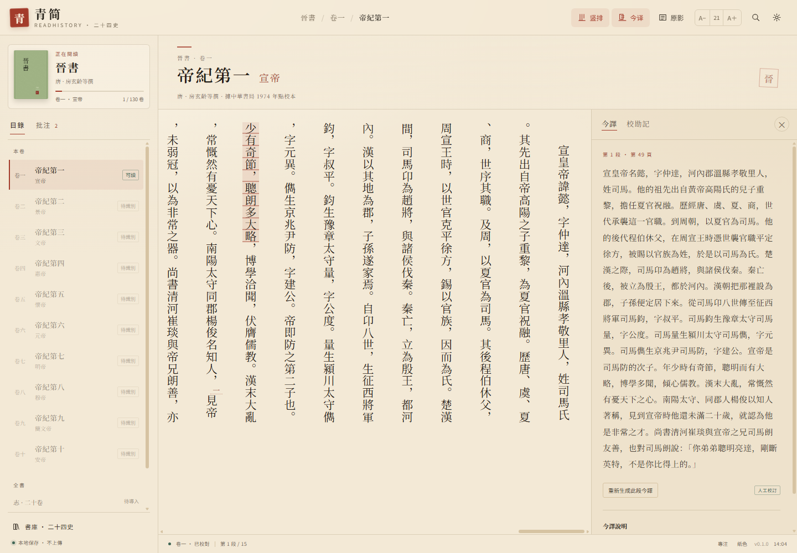

# 青简 · 二十四史阅读器

**青简（ReadHistory）** 是一款运行在 Windows 上的本地古籍阅读器。它把你手上的扫描版史书 PDF 做本地 OCR，重排成可检索、可批注的竖排 / 横排正文，不需要上传到任何服务器。

当前版本 **0.2.5**，下载：[GitHub Releases](https://github.com/ldk689/ReadHistory/releases/latest)。

## 特色功能

- **自动导入扫描 PDF**：逐页识别封面、版权页、目录并自动跳过；逐页判断横排 / 竖排与扫描方向，识别不稳时自动换向重试。OCR 全程在本机完成。
- **竖排 / 横排阅读**：竖排按列右起阅读，横排一键切换；字号可调，提供纸色、月白、墨夜三套主题。
- **仿古籍界面**：纸纹底、朱砂印、双线边框；宋体、黑体、楷体三选一。
- **原影对照**：随时打开对应扫描页，支持全屏放大，便于逐字校对。
- **批注与检索**：选中文字可高亮、划线、写批注、复制；支持全文检索、阅读进度与校勘记。
- **可调界面与阅读**：界面字号、减少动效、行距、段距、正文宽度、竖排列距，以及是否记住上次阅读、自动保存进度。
- **本地优先**：PDF、OCR 文本、批注、进度都留在本机；没有账号、没有统计上传，也不连接翻译服务。

## 使用方法

1. 从 [Releases](https://github.com/ldk689/ReadHistory/releases/latest) 下载 ZIP，**完整解压**后双击 `Qingjian_ReadHistory.exe`。ZIP 属性若有「解除封鎖」，请先勾选再解压。
2. 点左下角 **「导入 PDF」**，选择扫描本，确认版式、页码范围，开始后台 OCR。
3. 识别完成后即可竖排 / 横排阅读；选中文字可批注，顶栏可打开原影、校勘、搜索与设置。
4. 关闭窗口只是隐藏到托盘；右键托盘「青」图标 → **退出青简**。

阅读窗口使用 Windows 自带的 WebView2，不依赖外部 Edge 标签页；Windows 10 若缺少 WebView2 Runtime，可安装 Microsoft Edge WebView2 Evergreen Runtime。

> 程序暂未做代码签名，首次运行可能触发 SmartScreen；确认来自本项目 Release 后，点「更多信息 → 仍要运行」。

## 字体与许可证

| 用途 | 字体 | 许可 | 是否随程序分发 |
|---|---|---|---|
| 宋体 | Noto Serif SC | SIL OFL 1.1 | 是 |
| 黑体 | Noto Sans SC | SIL OFL 1.1 | 是 |
| 楷体 | AR PL UKai TW | Arphic Public License | 是 |
| 西文 | Times New Roman | Monotype 商业字体 | 否，仅调用本机字体 |

- 程序代码以 **MIT License** 开源。
- 字体、Python 运行时、PDFium、RapidOCR、ONNX Runtime、OpenCV、NumPy、Pillow 等第三方组件适用各自许可证，全文见 [`LICENSES/`](LICENSES/) 与 [`THIRD_PARTY_NOTICES.md`](THIRD_PARTY_NOTICES.md)。
- 样章文本参校维基文库《晉書》卷001（CC BY-SA 4.0），古籍原文本身属于公有领域；扫描 PDF 与出版社封面不随程序分发。

## 已知限制

- 竖排 OCR 对双行小注、朱批、行草、严重残缺的刻本仍不稳定，识别结果需要对照原影校对。
- 自动版式判断依赖正文页；封面、牌记、空白页可能误判，可更换起始页或手动选择版式。
- 导入整本大 PDF 的 OCR 可能耗时数小时，建议先识别 10–20 页试读。
- 仅支持 64 位 Windows 10 / 11；未签名程序首次运行可能出现 SmartScreen 提示。
