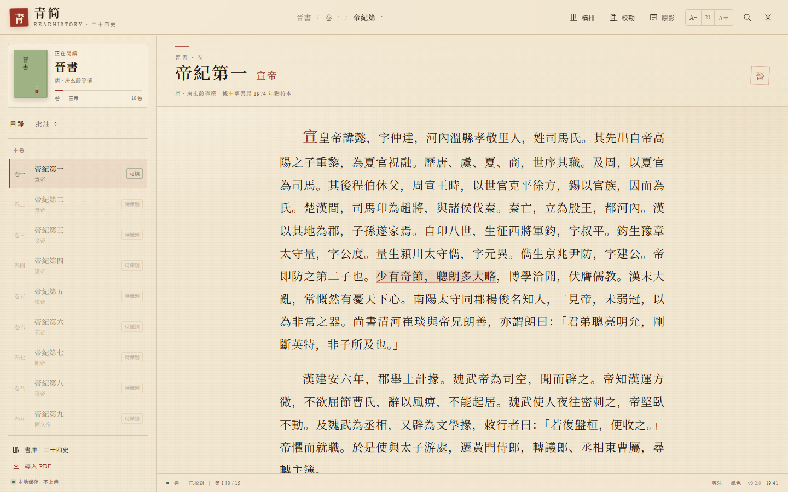

# 青简 · 二十四史阅读器

**青简（ReadHistory）** 是一个把扫描版古籍 PDF 变成可检索、可批注的竖排 / 横排阅读器的本地应用。

当前版本 **0.2.0**。Windows 版采用 **「小体积 EXE + `runtime` 运行目录」** 的可携式布局：`Qingjian_ReadHistory.exe` 只有约 46 KB，Python、OCR 模型、字体等放在同目录的 `runtime/` 中，双击 EXE 即可运行。电脑上不需要安装 Python，也不需要联网配置模型。原 0.1.0 的「现代汉语今译」功能已整体移除。


横排模式：



## 这一版做了什么

- **小 EXE + 运行目录**：`Qingjian_ReadHistory.exe` 只负责启动、选端口、打开内置阅读窗口和托盘；Python 3.12、PDFium、RapidOCR、繁体中文模型与开源字体都在 `runtime/` 中。不再把 300 多 MB 塞进 EXE，启动时也不需要解包。
- **自带窗口，不依赖外部浏览器**：阅读界面在程序自己的 WebView2 窗口中打开，不再启动 Microsoft Edge 标签页；只有用户从托盘选择「在瀏覽器中打開」或内置窗口初始化失败时才回退到浏览器。
- **可诊断**：启动日志写在程序目录的 `logs/` 中，不会自动删除；启动失败会弹出可复制错误详情的窗口；另附 `診斷.bat`，双击即可看到控制台错误。
- **导入自己的 PDF**：在「书库 → 导入 PDF」选择扫描本，程序会先试读一两页，**自动判断竖排 / 横排**，并纠正 90°/180°/270° 的扫描方向；判断不准时可手动指定版式。
- **竖排古籍 OCR**：对竖排书按「直行切分 → 单字切格 → 横向重排识别」处理，保留从右到左的阅读顺序；横排书继续使用整行识别。
- **移除今译**：删除了今译面板、选段翻译、模型接口、API Key 设置和 `translate.py`；应用不再连接任何翻译服务。
- **字体切换**：宋体、黑体、楷体三选一；宋/黑使用随程序附带的 Noto Serif SC / Noto Sans SC（SIL OFL 1.1），楷体使用随程序附带的霞鹜文楷（LXGW WenKai，OFL 1.1）；西文优先 Times New Roman。
- **古朴界面**：纸色、月白、墨夜三套主题，纸纹底、朱砂印、双线边框与宋体标题，尽量减少现代卡片感。
- **本地优先**：PDF、OCR 文本、批注、阅读进度都保存在本机；程序只监听 `127.0.0.1`，没有统计与上传逻辑。

## 直接使用（推荐）

1. 下载 `Qingjian_ReadHistory-0.2.0-win64.zip`（约 235 MB）。
2. **完整解压**到任意可写目录（例如 `D:\QingJian`），不要只把 EXE 单独拖出来：
   ```
   QingJian\
     Qingjian_ReadHistory.exe      ← 约 46 KB
     runtime\                      ← Python / OCR / 字体
     data\                         ← 首次启动后生成
     logs\                         ← 首次启动后生成
     使用說明.txt
     啟動青簡.bat
     備用啟動.bat
     診斷.bat
   ```
3. 双击 `Qingjian_ReadHistory.exe`。10–30 秒内会打开青简自己的阅读窗口（不是外部 Edge 标签页）。
4. 点左下角 **「导入 PDF」**，选择扫描本；确认版式与页码后开始后台 OCR。
5. 关闭程序：右键任务栏托盘里的「青」图标 → **退出青简**。

如果 ZIP 文件的「属性」里有「解除封鎖 / Unblock」勾选框，请先勾选再解压；否则 Windows 可能把「来自其他计算机」的标记传给 `python.exe`，导致它被拦截。

如果 EXE 被 Windows 拦下，可先试 `啟動青簡.bat` 或 `備用啟動.bat`；仍失败则运行 `診斷.bat`，它会保留一个显示错误信息的控制台窗口。

> Windows 可能对未签名程序弹出 SmartScreen 提示。确认文件来自本项目 Release 后，点「更多信息 → 仍要运行」。代码签名只影响这个提示，不是启动失败的根因；启动器已把详细错误写进 `logs\launcher.log` 和 `logs\server.log`。

内置窗口使用 Windows 自带的 **WebView2 Runtime**（Windows 11 默认安装；Windows 10 若缺失可安装 Microsoft Edge WebView2 Evergreen Runtime）。如果 WebView2 初始化失败，窗口内会显示原因，并提供「在瀏覽器中打開」与「重試」；也可以用 `備用啟動.bat` 直接走浏览器模式。

### 数据放在哪里

可携版的全部可写数据都在程序目录：

```
data\reader.db     批注、进度、设置、OCR 记录
data\library\      导入的 PDF
data\pages\        原影缓存
logs\              launcher.log / server.log
```

升级时保留 `data\`，替换 `runtime\` 与 EXE 即可。备份 `data\` 就是备份全部阅读数据。

卸载：托盘退出后，直接删除整个 `QingJian` 目录；不会残留系统服务或注册表项。

## 导入与排版识别

- **自动**：分别用横排与竖排两条管线试读候选页面，比较识别置信度与有效字数，选择更像正文的一侧；同时在 0°/90°/180°/270° 中选扫描方向。
- **手动**：如果自动判断不准，在导入窗口直接选「竖排」或「横排」，程序会按该版式重新试读并确定方向。
- **竖排切字**：先用墨迹投影找出直行，再按字格宽度拟合每列的字数，把每个字裁成独立方块，横向排成一行后交给识别模型，避免把整列旋转 90° 导致字形倒置。
- **分段**：竖排按「首字缩进 / 短行结束」粗略分段；横排按缩进、行距与句读分段。古籍的双行小注、朱批、异体字仍可能识别不准，建议在「设置 → 查看识别初稿」里逐页校对。

## 字体与许可证

| 用途 | 字体 | 许可 | 是否随程序分发 |
|---|---|---|---|
| 宋体 | Noto Serif SC | SIL OFL 1.1 | 是 |
| 黑体 | Noto Sans SC | SIL OFL 1.1 | 是 |
| 楷体 | 霞鹜文楷（LXGW WenKai） | SIL OFL 1.1 | 是 |
| 西文 | Times New Roman（优先） | Monotype 商业字体 | 否，仅调用本机字体 |

Times New Roman **不是** 开源字体，不能随程序再分发；程序只优先使用用户机器上已安装的副本，缺失时依次回退到 Tinos / Liberation Serif / 内置宋体。楷体则使用随程序附带的 [霞鹜文楷](https://github.com/lxgw/LxgwWenKai)（OFL 1.1），不依赖系统楷体。

## 从源码运行

要求 Python 3.11 / 3.12。

```powershell
python -m venv .venv
.venv\Scripts\python -m pip install -r requirements.txt
.venv\Scripts\python run.py --open
```

源码运行时数据在 `data/` 下；设置 `READHISTORY_HOME` 可把可写数据指向其他目录，设置 `READHISTORY_PDF` 可指定《晋书》样章的 PDF。

重新打可携版：

```powershell
# 先把便携包里的 python/ 解压到 .build/rt（只需一次）
powershell -ExecutionPolicy Bypass -File tools\build_exe.ps1   # 准备 .build/payload
powershell -ExecutionPolicy Bypass -File tools\build_portable.ps1
```

`build_portable.ps1` 会编译约 46 KB 的启动器、复制 `runtime/`、写入说明与诊断脚本，并输出 `dist/Qingjian_ReadHistory-0.2.0-win64.zip` 和 SHA256。`build_exe.ps1` 仍可生成旧式单文件 EXE（约 319 MB），仅作为兼容选项。

## 目录

```
run.py                   启动入口
reader/
  server.py              HTTP 服务、书库、导入与 OCR 任务
  db.py                  SQLite 数据层、种子导入
  ocr.py                 横排 / 竖排识别、方向判断、重排
  paths.py               应用目录与可写数据目录
web/                     阅读器、导入向导、字体与样式
data/seed/               《晋书》卷一校对本
tools/launcher/          C# 启动器（可携版 / 单文件版共用）
tools/build_portable.ps1 小 EXE + runtime 可携版打包脚本
tools/build_exe.ps1      旧式单文件 EXE 打包脚本
LICENSES/                第三方组件与字体许可证
THIRD_PARTY_NOTICES.md   第三方组件说明
docs/LICENSING.md        内置运行环境与再分发的许可分析
docs/TROUBLESHOOTING.md  启动失败、SmartScreen、日志与诊断
```

## 许可证

本项目代码以 [MIT License](LICENSE) 开源。第三方组件、字体、Python 运行时与样章文本适用各自许可证；打包与再分发的边界见 [docs/LICENSING.md](docs/LICENSING.md) 与 [THIRD_PARTY_NOTICES.md](THIRD_PARTY_NOTICES.md)。

## 已知限制

- 只内置了《晋书》卷一校对本作为开箱样章；其余史书需要自己导入 PDF。
- 竖排 OCR 对双行小注、朱批、行草、严重残缺的刻本仍不稳定；识别结果是「初稿」，需要在原影对照下校对。
- 自动版式判断依赖正文页；封面、牌记、空白页可能判断失败，换一个起始页或在导入时手动选版式即可。
- 不支持跨段落选择；竖排目前按列切分，超长段落会继续向左延伸。
- 启动器 EXE 未做代码签名，首次运行可能出现 SmartScreen 提示；可先用 `備用啟動.bat` 绕过启动器。

## English overview

**QingJian (ReadHistory) 0.2.0** is a local-first reader for scanned Chinese historical books. The Windows release is a portable folder: a ~46 KB launcher EXE plus a `runtime/` directory containing Python, PDFium, RapidOCR and open-source fonts. Users can import a scanned PDF, let the app detect vertical or horizontal typesetting (with manual override), OCR it locally, and read the result in vertical or horizontal modes with notes, highlights, original-scan comparison and full-text search.

Modern-Chinese translation has been removed in 0.2.0. The bundled fonts are Noto Serif SC, Noto Sans SC, and LXGW WenKai (all OFL 1.1); Times New Roman is referenced from the local system and never redistributed. Source code is MIT-licensed; see `docs/LICENSING.md` for the redistribution analysis.
